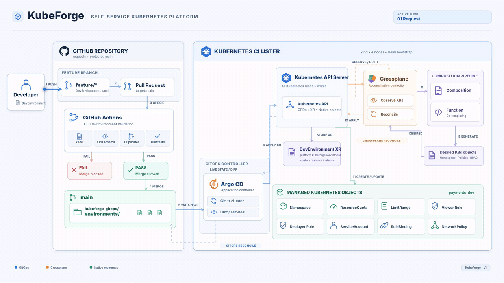
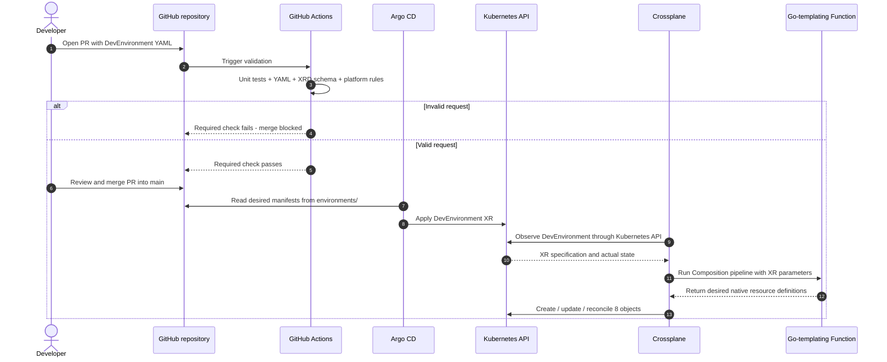
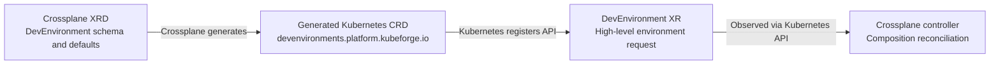

# KubeForge

### Self-service Kubernetes development environments — powered by Crossplane and GitOps

**One high-level YAML request → eight automatically provisioned and continuously managed Kubernetes resources.**


KubeForge is a **GitOps-driven Internal Developer Platform (IDP) prototype** that lets development teams request, update, and remove standardized Kubernetes workspaces inside an **existing shared cluster**. Developers declare *what they need* through a small `DevEnvironment` manifest; the platform takes care of *how the environment is configured and maintained*.

**[Architecture](#architecture--responsibilities) · [Developer experience](#the-developer-experience) · [How it works](#how-kubeforge-works) · [Getting started](#getting-started) · [Testing](#testing--validation) · [Limitations](#limitations--security-considerations)**



> **Scope:** KubeForge creates **logical development environments within an existing Kubernetes cluster**—not new clusters, VMs, or application deployments. This is a locally tested platform-engineering prototype, not a production multi-tenant security solution.

## The problem and the idea

In a shared Kubernetes cluster, bringing up a new team environment typically involves more than creating a Namespace. Someone must also configure resource budgets, container defaults and limits, permissions, service identities, and network policies—and keep them consistent as requirements change.

Doing this separately for every environment introduces recurring problems:

- **Developer friction:** developers depend on manual platform-team setup for routine requests.
- **Infrastructure complexity:** multiple low-level manifests have to be understood, written, and maintained.
- **Configuration inconsistency:** resource limits, access privileges, and network rules can diverge between teams.
- **Operational overhead:** environment updates, configuration drift, and cleanup require repeated intervention.

**KubeForge shifts this work into the platform.** Platform Engineers define the supported options and governance policies **once**; developers use a small self-service API to request environments that follow those standards.

| Without KubeForge | With KubeForge |
| --- | --- |
| Prepare and maintain several Kubernetes resource manifests for each workspace | Submit one `DevEnvironment` manifest |
| Request routine environment setup from the platform team | Use a reviewed, Git-based self-service workflow |
| Repeat quota, RBAC, and network-policy configuration | Apply consistent policies generated by the platform |
| Update and clean up resources manually | Reconcile lifecycle changes declaratively through GitOps and Crossplane |

The goal is **developer autonomy for routine provisioning without losing centralized infrastructure governance**. Platform Engineers still own the API, templates, permissions, and supported configurations; developers still deploy their own applications into the resulting Namespace.

## The developer experience

A developer adds a YAML file to [`kubeforge-gitops/environments/`](kubeforge-gitops/environments/), for example `payments-dev.yaml`:

```yaml
apiVersion: platform.kubeforge.io/v1alpha1
kind: DevEnvironment
metadata:
  name: payments-dev
spec:
  team: payments
  size: small
  networkProfile: isolated
```

That file describes **one instance of a Kubernetes custom resource type** introduced by KubeForge—not eight separate low-level Kubernetes manifests. `payments-dev` is only an example; the platform supports multiple environment names and teams.

| Developer-facing field | Purpose | Supported input |
| --- | --- | --- |
| `metadata.name` | Identifies the environment and its Namespace | Valid, nonreserved lowercase Kubernetes-style name |
| `spec.team` | Team identifier used by the platform | Validated lowercase team name |
| `spec.size` | Selects platform-defined resource budgets and container constraints | `small` or `medium` |
| `spec.networkProfile` | Selects a predefined network-policy configuration | `isolated` (default) or `standard`; **optional** |

A developer **does not** specify individual Role rules, ResourceQuota objects, NetworkPolicy selectors, or other implementation details. Those are owned by the platform.

**Developer journey:** create or edit the YAML → open a Pull Request → receive CI feedback → merge an approved, passing PR → Argo CD synchronizes the custom resource → Crossplane provisions or updates the environment.

## Architecture & responsibilities

KubeForge separates **validation**, **delivery of desired state**, and **environment reconciliation**. Each component has a distinct responsibility.



> The diagram shows the **successful creation path**. During updates and deletion, Argo CD changes or prunes the `DevEnvironment` XR, and Crossplane reconciles the corresponding native resources. All cluster changes pass through the **Kubernetes API Server**; the Function does not create resources directly.

| Component | What it owns | What it does **not** do |
| --- | --- | --- |
| **GitHub Actions** | Static validation of proposed `DevEnvironment` files and validator unit tests | Provision environments or deploy to the cluster |
| **Argo CD** | Git → Kubernetes synchronization of `DevEnvironment` XRs; self-healing and pruning | Generate Namespaces, quotas, or RBAC |
| **Crossplane** | `DevEnvironment` XR → native Kubernetes resource generation and reconciliation | Replace Argo CD's Git synchronization |
| **Kubernetes API Server** | API registration, object admission, storage, and access to native resources | Interpret developer requests into an environment on its own |

### Two complementary reconciliation loops

1. **Argo CD: Git → `DevEnvironment` XR.** Argo CD watches the configured repository path on `main` and compares its manifests with the corresponding custom resources in Kubernetes. Automatic sync applies changes; self-healing restores out-of-band changes to Argo CD-managed XRs; pruning removes XRs whose files were deleted from Git.
2. **Crossplane: `DevEnvironment` XR → eight resources.** Crossplane observes each XR through Kubernetes, invokes its Composition pipeline, and reconciles native resources toward the generated desired state. It handles initial provisioning, configuration changes, drift correction, and deletion of owned resources.

These loops work **at different levels**. For example, manually modifying a ResourceQuota is corrected by **Crossplane**, whereas manually modifying an Argo CD-managed `DevEnvironment` specification is corrected by **Argo CD**.

## How KubeForge works

### 1. Extending the Kubernetes API with Crossplane

KubeForge implements its developer-facing contract in [`kubeforge-platform/manifests/xrds/dev-environment.yaml`](kubeforge-platform/manifests/xrds/dev-environment.yaml).

The **CompositeResourceDefinition (XRD)** declares the `DevEnvironment` API group, version, cluster scope, schema, allowed parameters, and default Composition. Crossplane's XRD controller then generates and maintains a Kubernetes **CustomResourceDefinition (CRD)**. Once Kubernetes registers that CRD, it can recognize, validate, and store `DevEnvironment` objects as **Composite Resources (XRs)**.



This is more than a reusable YAML template: **KubeForge introduces a higher-level Kubernetes API** that abstracts environment implementation details while restricting what developers are allowed to request.

### 2. Composition pipeline and native resource provisioning

The [`Composition`](kubeforge-platform/manifests/compositions/dev-environment.yaml) maps `DevEnvironment` parameters to concrete Kubernetes objects. It runs in **Pipeline** mode and invokes the installed [`function-go-templating`](kubeforge-platform/manifests/functions/go-templating.yaml) package.

At reconciliation time:

1. Crossplane observes the XR and selects the Composition.
2. The Composition invokes the Go-templating Function with the observed request and resource state.
3. The Function evaluates the templates and **returns desired Kubernetes resource definitions**.
4. Crossplane creates, updates, or deletes those objects **through the Kubernetes API** and continues reconciling them.

The Function is a **prebuilt Crossplane package configured by this project**; KubeForge's implementation is the custom XRD, Composition, templates, RBAC, and integration—not a newly written Go Function binary.

**Exactly eight native Kubernetes resources are managed per `DevEnvironment`:**

| Resource | Generated name | Responsibility |
| --- | --- | --- |
| `Namespace` | `<environment-name>` | Logical workspace and scope for the remaining resources |
| `ResourceQuota` | `environment-quota` | Total namespace CPU/memory *request* budget |
| `LimitRange` | `environment-limits` | Defaults and constraints for per-container CPU/memory settings |
| `Role` | `environment-viewer` | Read-only workload permissions; **not bound to a user by default** |
| `Role` | `environment-deployer` | Deploy/manage application workloads without granting governance administration |
| `ServiceAccount` | `environment-deployer` | Namespaced identity intended for deployment automation |
| `RoleBinding` | `environment-deployer` | Binds the deployer ServiceAccount to the deployer Role |
| `NetworkPolicy` | `environment-network-policy` | Namespace-wide ingress/egress rules from the selected profile |

Seven of these objects live **inside the generated Namespace**; the Namespace itself is cluster-scoped. The resources are maintained by Crossplane rather than applied as eight unrelated Git manifests.

### 3. Built-in resource and access governance

**Resource budgets.** The developer chooses `small` or `medium`; the Composition selects the predefined quota and container settings.

| Size | Namespace `requests.cpu` quota | Namespace `requests.memory` quota |
| --- | ---: | ---: |
| `small` | 2 CPU | 4 GiB |
| `medium` | 4 CPU | 8 GiB |

`ResourceQuota` constrains the **aggregate declared requests** in a Namespace. `LimitRange` operates at the **container level**, providing default requests/limits and enforcing configured boundaries. Neither mechanism provisions extra nodes or guarantees exclusive CPU/memory reservations. Kubernetes admission and scheduling still determine whether individual workloads can run.

**Access controls.** Every environment includes two distinct namespaced Roles:

- `environment-viewer` provides a read-only role definition; it is **not automatically assigned to developers**.
- `environment-deployer` allows managing typical application workloads and is bound to the dedicated `environment-deployer` ServiceAccount. It does not grant administration of RBAC objects, ResourceQuotas, NetworkPolicies, or Secrets under its defined permissions.

Crossplane is granted the Kubernetes permissions required to manage these resources through the platform's [RBAC manifest](kubeforge-platform/manifests/rbac/crossplane-native-resources.yaml). Developer-facing choices remain intentionally limited; RBAC rules are platform-defined rather than configurable in each request.

**Network policy profiles.** Developers select a profile; the Composition generates the corresponding `NetworkPolicy` covering all Pods in the environment Namespace.

| Intended connectivity | `isolated` (default) | `standard` |
| --- | --- | --- |
| Pod traffic within the same Namespace | Allowed | Allowed |
| DNS access to Kubernetes DNS | Allowed | Allowed |
| Outbound HTTPS (TCP/443) to allowed public IPv4 destinations | Not allowed | Allowed |
| Traffic between development Namespaces | Excluded by the generated rules | Excluded by the generated rules |
| Other outbound traffic | Not allowed by the generated rules | Not allowed by the generated rules |

The `standard` profile excludes private/reserved destination ranges from its public-HTTPS allowance. **These are the intended rules of the generated policy, not a claim that traffic isolation was proven at runtime.** Kubernetes NetworkPolicies are additive, and enforcement depends on a compatible, functioning CNI; see [Limitations](#limitations--security-considerations).

### 4. Shift-left validation with GitHub Actions

The developer does not have to wait for an Argo CD or Kubernetes error to discover an invalid request.

KubeForge includes a [Python validator](kubeforge-gitops/scripts/validate-environments.py), executed by [GitHub Actions](.github/workflows/validate-devenvironments.yml) on Pull Requests targeting `main`. It validates the **`DevEnvironment` YAML files in the GitOps environments directory**, not the Pull Request's prose or generic repository content.

The validator checks:

- **Schema:** `apiVersion`, `kind`, required fields, values, and types against the actual Crossplane **XRD**, used as the source of truth.
- **YAML integrity:** syntactic validity, duplicate mapping keys, and exactly one nonempty YAML document per request file.
- **Platform guardrails:** allowed metadata, valid/nonreserved environment names, unexpected `spec` fields, and duplicate `DevEnvironment` names.
- **GitOps alignment:** files must be top-level `*.yaml` files in the directory that Argo CD actually synchronizes; misplaced or `.yml` requests are rejected rather than silently ignored.

The workflow installs the Python dependencies, runs the validator's **13 unit tests**, and checks all requests. Validation errors appear in GitHub Actions and as PR annotations. A **required `validate-devenvironments` status check in the GitHub `main` branch ruleset** prevents a failed validation from being merged.

> **Validation boundary:** Passing CI means the request satisfies the *implemented static checks*. It does **not** guarantee runtime provisioning: admission constraints, available capacity, component failures, or other cluster conditions may still prevent success. CI does not need Kubernetes access or cluster credentials.

### 5. GitOps synchronization with Argo CD

KubeForge configures:

- An **`AppProject`** named `kubeforge`, restricting the allowed Git source and Kubernetes resource types.
- An **`Application`** named `kubeforge-environments`, pointing to `main` and `kubeforge-gitops/environments/`.

The Application reads **top-level `*.yaml` files**, with recursive directory traversal disabled, and uses **automatic synchronization, self-healing, and pruning**.

Argo CD applies the developer's `DevEnvironment` XR **through the Kubernetes API Server**. It does **not** create the eight native objects directly; after the XR is admitted, Crossplane observes it and reconciles its resource set.

### 6. Declarative lifecycle: create, update, delete

| Git change | Argo CD responsibility | Crossplane responsibility |
| --- | --- | --- |
| **Create** a `DevEnvironment` YAML | Apply a new XR | Provision the Namespace and seven namespaced objects |
| **Update** `size` or `networkProfile` | Update the XR to match Git | Re-render and reconcile changed quotas, limits, or network policy |
| **Delete** the YAML file | Prune the managed XR | Clean up the composed resources, including the Namespace |
| **Restore** from drift | Restore an Argo CD-managed XR if it was changed out of band | Restore native managed objects to the Composition's desired state |

> **Destructive action:** Deleting a `DevEnvironment` removes its generated Namespace and **any workloads/data stored there that depend on that Namespace**. Demonstrate deletion only with disposable environments. Resource cleanup is subject to successful controller and Kubernetes deletion processing.

## Testing & validation

KubeForge was tested locally on a **four-node kind cluster** (one control-plane node and three workers), with GitOps lifecycle behavior and Crossplane resource reconciliation checked separately.

### Automated Crossplane lifecycle E2E suite

The project includes [`kubeforge-platform/tests/e2e/run-e2e.sh`](kubeforge-platform/tests/e2e/run-e2e.sh): a **10-stage automated end-to-end test suite** that uses a disposable `DevEnvironment` to exercise the provisioning and reconciliation lifecycle.

| Stage | What is verified |
| --- | --- |
| 1. Prerequisites | Kubernetes API and required Crossplane components are available |
| 2. Request creation | A temporary XR is admitted and its Namespace is created |
| 3. Composition | All eight managed resources exist and the XR becomes ready/synced |
| 4. Initial settings | Expected quota, limits, RBAC objects, and default network-policy configuration |
| 5. Admission behavior | LimitRange and ResourceQuota constraints through Kubernetes server-side dry runs |
| 6. RBAC behavior | Deployer ServiceAccount authorization and restricted operations via impersonation |
| 7. Declarative updates | `small → medium` and `isolated → standard` update existing resources |
| 8. Drift recovery | Crossplane restores a manually changed ResourceQuota |
| 9. Policy reconfiguration | Switching back to `isolated` removes the public HTTPS egress allowance |
| 10. Cleanup | The temporary XR and its managed Namespace are deleted |

**Result: all 10 E2E stages passed.** Separately, the GitOps create/update/delete flow was validated through Argo CD, and the CI validation rules were tested with both valid and invalid Pull Requests.

**Important:** The suite verifies that NetworkPolicy resources and their rules are generated and reconciled correctly; it does **not** prove that packet-level traffic isolation was enforced on the tested Windows/WSL2 kind cluster.

### Run validation locally

From the repository root:

```bash
python -m pip install -r kubeforge-gitops/scripts/requirements-ci.txt

python -m unittest discover -s kubeforge-gitops/tests -p 'test_*.py' -v

python kubeforge-gitops/scripts/validate-environments.py \
  --xrd kubeforge-platform/manifests/xrds/dev-environment.yaml \
  --environments kubeforge-gitops/environments
```

Run the E2E suite once the cluster and platform are installed:

```bash
cd kubeforge-platform
bash tests/e2e/run-e2e.sh
```

## Getting started

### Requirements

The provided scripts target **Windows 10/11, Docker Desktop with WSL2/Linux containers, and Git Bash**. Install `git`, `kind`, `kubectl`, and Docker Desktop first. The bootstrap module installs/configures the pinned Helm and Crossplane versions.

Recommended resources for the four-node local cluster: **12 GB or more available to Docker/WSL2** (8 GB may work but is tight). Internet access is required for the cluster/node images and controller packages. Python 3.12 is needed for local CI validation, not for cluster bootstrap.

The scripts use the kubeconfig context **`kind-kubeforge`**. Check it before running commands on another cluster.

### Step 1 — Clone KubeForge

```bash
git clone https://github.com/chedli01/KubeForge.git
cd KubeForge
```

### Step 2 — Bootstrap Kubernetes and Crossplane

```bash
cd kubeforge-bootstrap
bash scripts/10-setup-all.sh
```

This creates the `kubeforge` kind cluster (one control-plane + three workers), installs Helm and Crossplane, and verifies readiness.

```bash
kubectl --context kind-kubeforge get nodes
kubectl --context kind-kubeforge -n crossplane-system get pods
```

See [Bootstrap module](kubeforge-bootstrap/README.md) for the individual scripts.

### Step 3 — Register the custom API and Composition

```bash
cd ../kubeforge-platform
bash scripts/setup.sh
```

The platform setup registers the XRD, installs the Go-templating Function, applies the required Crossplane RBAC and Composition, and creates/verifies a **directly applied demo** `DevEnvironment` (`payments-dev`).

```bash
kubectl --context kind-kubeforge get devenvironments
kubectl --context kind-kubeforge get composition kubeforge-devenvironment
kubectl --context kind-kubeforge -n payments-dev \
  get resourcequota,limitrange,roles,serviceaccounts,rolebindings,networkpolicies
```

The demo XR in this step is **not** a GitOps-delivered request. The next step configures Argo CD for that workflow.

See [Platform module](kubeforge-platform/README.md) for more details.

### Step 4 — Configure GitOps and Argo CD

```bash
cd ../kubeforge-gitops
cp config/gitops.env.example config/gitops.env
```

Update the local `config/gitops.env` file (do **not** commit credentials or other local secrets):

```dotenv
KUBE_CONTEXT=kind-kubeforge
ARGOCD_VERSION=v3.5.4
GIT_REPO_URL=https://github.com/chedli01/KubeForge.git
GIT_REVISION=main
GIT_PATH=kubeforge-gitops/environments
APP_NAME=kubeforge-environments
TEST_ENV=gitops-demo
```

Ensure `kubeforge-gitops/environments/gitops-demo.yaml` is **committed and pushed to `main`** if using the module's default verification. Argo CD reads remote Git, not your uncommitted working directory.

For a **public repository**:

```bash
bash scripts/setup.sh
```

For a **private repository**, use the provided credential helper before configuring the Application:

```bash
bash scripts/install-argocd.sh
bash scripts/connect-private-repo.sh
bash scripts/configure-application.sh
bash scripts/verify-gitops.sh
```

Then inspect the Application and managed XR:

```bash
kubectl --context kind-kubeforge -n argocd get applications
kubectl --context kind-kubeforge get devenvironments
kubectl --context kind-kubeforge -n gitops-demo get resourcequota,networkpolicy
```

Open the UI using the module's dashboard helper:

```bash
bash scripts/open-dashboard.sh
```

Visit `https://localhost:8080` while the port-forward is running (the local certificate may be untrusted). See [GitOps module](kubeforge-gitops/README.md) for detailed setup.

### Step 5 — Exercise the end-to-end GitOps workflow

1. **Create:** add a valid top-level `*.yaml` request in `kubeforge-gitops/environments/` on a feature branch, open a PR, let validation run, and merge once checks/review pass.
2. **Update:** change the existing request's `size` or `networkProfile`, pass CI, and merge; Argo CD updates the XR and Crossplane reconciles the native objects.
3. **Delete:** remove that YAML file through a reviewed PR; Argo CD prunes its XR and Crossplane cleans up the managed environment. Use a **disposable** environment.

To make the CI result enforceable, the GitHub branch ruleset on `main` must require the `validate-devenvironments` status check. A GitHub Actions failure **by itself** does not automatically forbid a merge.

## Repository structure

```text
KubeForge/
├── .github/workflows/
│   └── validate-devenvironments.yml       # PR validation and unit tests
├── kubeforge-bootstrap/
│   ├── config/                            # kind config and pinned versions
│   ├── scripts/                           # create cluster, install Helm/Crossplane
│   └── README.md
├── kubeforge-platform/
│   ├── manifests/
│   │   ├── xrds/                          # DevEnvironment API schema
│   │   ├── compositions/                  # Go-template resource composition
│   │   ├── functions/                     # Function package definition
│   │   └── rbac/                          # Crossplane native-resource permissions
│   ├── examples/                         # Direct XR examples
│   ├── scripts/                          # platform install/verification
│   ├── tests/e2e/run-e2e.sh              # 10-stage lifecycle E2E suite
│   └── README.md
├── kubeforge-gitops/
│   ├── config/                            # local Argo CD source configuration
│   ├── environments/                      # GitOps-managed DevEnvironment YAMLs
│   ├── manifests/                         # AppProject and Application templates
│   ├── scripts/                           # GitOps bootstrap and Python validator
│   ├── tests/test_validator.py            # validator unit tests
│   └── README.md
├── docs/assets/
│   └── kubeforge-architecture.gif         # architecture animation for this README
└── README.md
```

The modules reflect the platform's boundaries: **bootstrap prepares the cluster; platform defines the custom API and managed resources; GitOps validates and delivers developer requests**.

## Technology stack

| Area | Technologies |
| --- | --- |
| Local Kubernetes | Docker Desktop, WSL2, kind (1 control-plane + 3 workers), Kubernetes v1.34 |
| Kubernetes API and controllers | Crossplane v2.4, XRDs, CRDs, Composition (Pipeline mode) |
| Dynamic templates | `function-go-templating` v0.11.5 |
| GitOps | Argo CD v3.5.4 (`Application`, `AppProject`) |
| CI and validation | GitHub Actions, Python 3.12, PyYAML, jsonschema, GitHub branch ruleset |
| Installation and scripting | Helm v3.19, Bash, kubectl |

## Limitations & security considerations

- **NetworkPolicy enforcement not verified locally.** The generated `isolated` and `standard` policies were created and reconciled correctly, but **runtime traffic isolation was not established** on the tested Windows/WSL2 kind environment. An nftables/kernel capability issue was suspected; its exact cause was not conclusively proven. Use a working NetworkPolicy-capable CNI and independently test traffic enforcement before making isolation guarantees.
- **Not production-ready multi-tenancy.** Namespaces, quotas, RBAC and NetworkPolicy objects provide a useful governance foundation, not a complete security boundary for untrusted tenants. Production use would need stronger admission/Pod security controls, reviewed identity and privilege-escalation paths, and verified network isolation.
- **The deployer Role is intentionally limited, not a full tenant security model.** A principal that can create workloads may still have indirect effects through Pods; production RBAC and admission controls need further hardening. The viewer Role is not bound to human users automatically.
- **Static validation is not runtime assurance.** CI rejects malformed/unsupported requests before merge but does not detect every possible Kubernetes scheduling, admission, or controller failure.
- **Git-based self-service, not a developer portal.** This prototype intentionally uses YAML and Pull Requests. It provisions the environment into which developers deploy workloads; it does not deploy applications, configure full tenant identity onboarding, or create new Kubernetes clusters.

## Troubleshooting and cleanup

Inspect the source request, Argo CD Application, the resulting XR, and Crossplane controller logs **in that order**:

```bash
kubectl --context kind-kubeforge -n argocd get application kubeforge-environments
kubectl --context kind-kubeforge get devenvironments
kubectl --context kind-kubeforge describe devenvironment gitops-demo
kubectl --context kind-kubeforge -n crossplane-system logs deployment/crossplane --tail=100
```

- **CI failure:** read the GitHub Actions error annotation; fix the YAML or unsupported field before merging.
- **Argo CD OutOfSync / missing XR:** check the configured repository, `main`, the top-level `*.yaml` directory, and `AppProject` restrictions.
- **XR not Ready / missing managed resources:** inspect the `DevEnvironment`, Composition, Function, resource events, and Crossplane permissions/logs.
- **NetworkPolicy exists but traffic behaves unexpectedly:** verify the CNI implementation and dataplane enforcement; the existence of a NetworkPolicy object alone is not proof of isolation.

For a **GitOps-managed environment**, delete its YAML through a PR rather than directly deleting its XR (Argo CD may recreate it). For directly applied examples, delete the XR explicitly.

To **destroy the entire local kind cluster** (destructive):

```bash
cd kubeforge-bootstrap
bash scripts/99-destroy-cluster.sh
```

---

**KubeForge demonstrates a core Platform Engineering principle: give developers a simple, governed interface while automating the infrastructure complexity behind it.**
